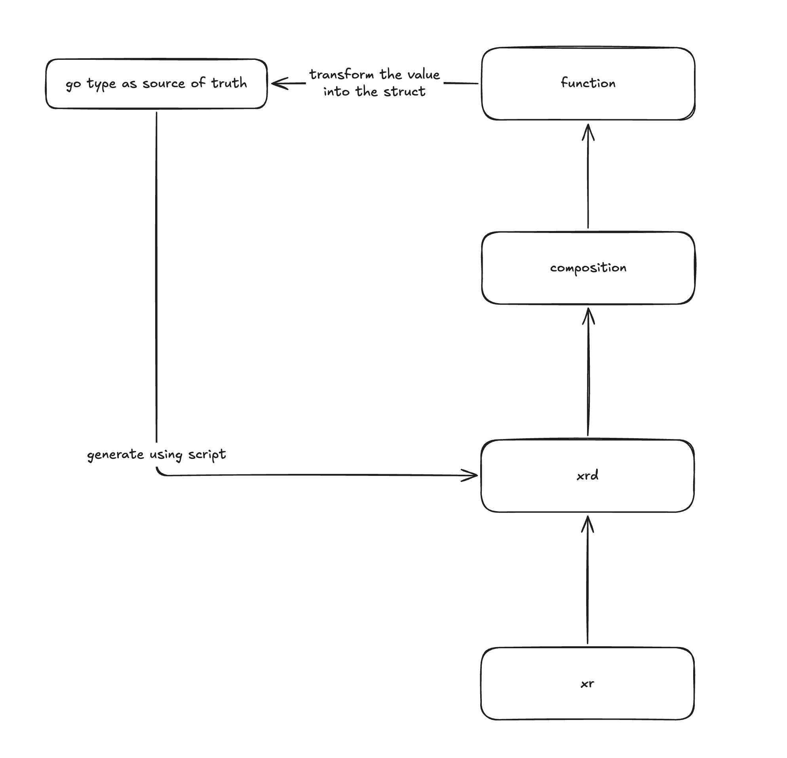

# function-s3
This repository contains a simple Crossplane function that renders a composite resource into AWS S3 managed resources, using type-safe Go types as the source of truth.

## Development flow
1. Update the types in `api/v1alpha1/types.go`.
2. Generate the CRD from the types with controller-gen using `make generate_crd_from_type`.
3. Generate the XRD from the CRD with the Python script using `make generate_xrd_from_crd`.
4. Update the logic in `fn.go`.
5. Run two terminals in parallel:
   - Run `make run` in the first to start the function locally.
   - Run `make render` in the second to render the example composition using `example/xr.yaml`.
